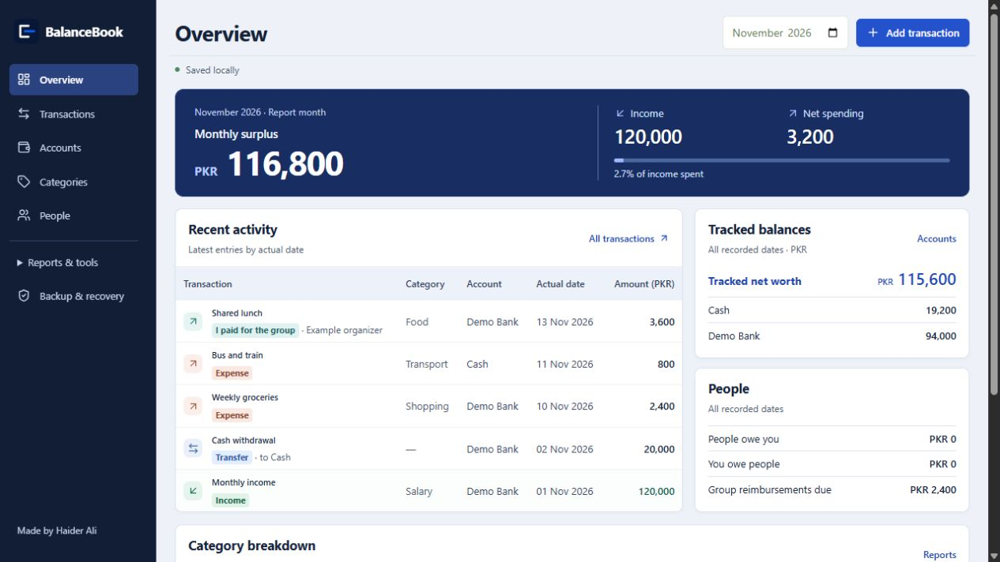
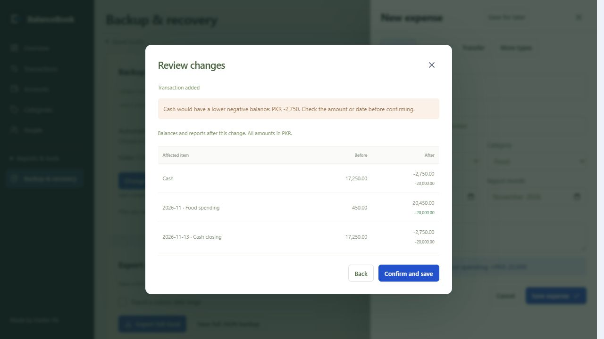
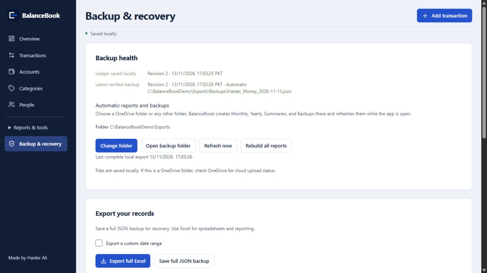

# BalanceBook

A local-first Windows money ledger for people who want to record expenses, transfers, loans and group reimbursements, understand balance changes, and keep verified recovery backups.

*Screenshots use an isolated synthetic ledger in a browser preview of the same React UI; they contain no real financial records.*

Balance preview and backup health

## Download for Windows

**[Download the single-file installer](https://github.com/4haiderali/BalanceBook/releases/latest)** — choose the file ending in `Setup-x64.exe`. Current release: **1.2.26**. No separate payload folder is required.

The installer is **unsigned**. Windows may show Unknown Publisher or SmartScreen. Only run a download you trust; compare its SHA-256 with the release checksum using `Get-FileHash .\BalanceBook-1.2.26-Setup-x64.exe -Algorithm SHA256`. A matching checksum verifies file integrity, not publisher identity. Microsoft Edge WebView2 Runtime is required.

## Get started

1. Install and open BalanceBook. A new desktop ledger starts with Cash and seven general categories, with no people, transactions or opening balances.
2. Add your own bank/wallet in Accounts and enter verified opening balances.
3. Add an expense. Check its account, category and date, then review the balance effects and confirm once.
4. Choose a dedicated export folder in Backup & recovery. Confirm that a verified JSON backup exists.

## Back up and restore

Open **Backup & recovery → Save full JSON backup**, then use **Choose JSON backup** to verify the file. Automatic exports create Monthly, Yearly, Summaries and Backups subfolders. A local OneDrive path does not prove that OneDrive uploaded the file.

To restore, choose **Recover from JSON backup**, select a full JSON backup, review the figures and confirm. The app stages validation separately and retains the former database. JSON retains the ledger snapshot and its transaction audit; it does not carry the entire SQLite saved-version history. See [Recovery and data locations](docs/RECOVERY.md).

## Update, uninstall and reinstall

Before updating important records, save and verify a backup. Setup verifies a disposable copy before replacing the app and requests a normal close. Keeping an open draft prevents replacement.

Use Windows **Installed apps → BalanceBook → Uninstall** to remove the application. Close BalanceBook first. **Uninstall keeps your ledger, saved history, preferences and exported backups.** Reinstall reopens retained data. Removing financial records is a separate manual decision; uninstall never purges them. See [installation details](docs/INSTALLATION.md).

## Features

- Expenses, transfers, lending, repayments and linked group receipts.
- Balance preview, reasoned corrections, recoverable deletion and audit history.
- Saved drafts, remembered active expense choices and duplicate comparisons.
- Backup health and automatic Excel/verified JSON outputs.

## Build and checks

Use Node.js 24: `npm ci`, `npm run typecheck`, then `npm test`. Windows packaging requires the .NET Framework compiler and runtime payload; single-file setup uses Inno Setup. Full commands and release checks: [Building](docs/BUILDING.md), [validation](docs/VALIDATION-1.2.26.md).

## Support and limitations

Report reproducible problems through [Issues](https://github.com/4haiderali/BalanceBook/issues). **Never attach a real ledger, backup, bank statement or credentials.** Use synthetic examples and redacted screenshots. Report vulnerabilities through [Security](SECURITY.md), not a public issue.

Tested on the Windows x64 PC described in the validation report. All Windows versions, DPI settings, power failures and sync providers have not been certified. Code signing remains planned. This is a local record-keeping app; it is not a banking service or an encrypted vault.

## License

Original project code is licensed under [MIT](LICENSE). Third-party components retain their licenses and notices; see [THIRD-PARTY-NOTICES.md](THIRD-PARTY-NOTICES.md).
