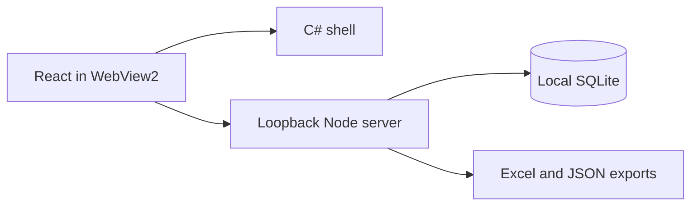

# Architecture

The C# Windows shell hosts WebView2 and starts a loopback Node server. Requests to ledger/report routes carry a per-launch session token. The Node server stores revisions in SQLite and serves the React UI. Report workers write local Excel and verified JSON files.

The installer is separate from ledger storage. Updating or uninstalling program files must never delete financial data. Historical migration compatibility fields may remain in ledger schemas, but personal transformation rules are not distributed.
